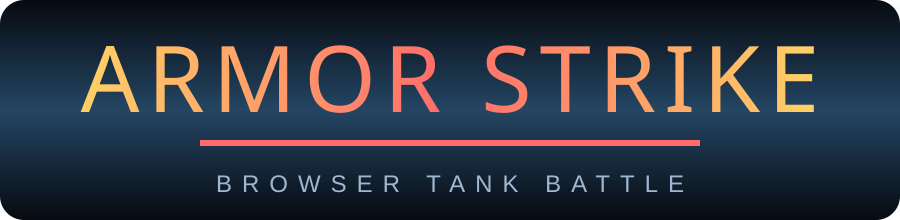
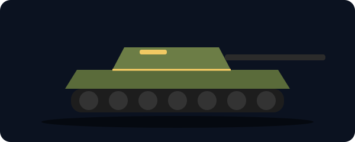
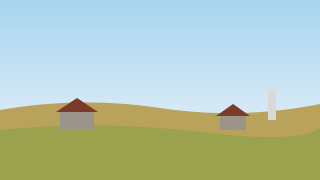
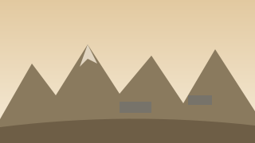

  

  

  

<b>Armor Strike</b> is a browser tank battle game. Pick a tank, learn how armour and penetration work, and fight in single-player or online multiplayer. Works on desktop and phone.

---

## Maps

Three battlefields, picked at random in single-player. Multiplayer rotates the map every 10 minutes.

<table>
  <tr>
    <td align="center"> <b>Steppe Farmland</b> Open ground, long sightlines</td>
    <td align="center"> <b>Forest Hills</b> Hills and trees, ambush cover</td>
    <td align="center"> <b>Ridge Valley</b> Ridgelines and bunkers</td>
  </tr>
</table>

## Features

- **Armour and penetration.** Shots are checked against the armour angle and thickness of each tank. Ricochets and penetration are shown on the crosshair.
- **Tank tree.** Research and buy tanks through the German, American, Soviet and Japanese trees, paid for with research points (RP) and SL.
- **Single-player and multiplayer.** Online battles run through Photon Realtime.
- **Customisable controls.** Rebind keys, change sensitivity, and set mobile control size, opacity and side.
- **Graphics settings.** Max FPS, graphics level, render quality and aspect ratio (16:9 or stretched 4:3).
- **Motion menu.** Swipe to turn the showcase tank in the garage.

## Controls

| Action | Desktop | Phone |
| --- | --- | --- |
| Drive | W A S D | Left joystick |
| Aim turret | Mouse (click to lock) | Drag the right side |
| Main gun | Left click | FIRE |
| Machine gun | Space | MG |
| Scope | Right click or Shift | SCOPE |

All keys can be changed in **Settings**.

## Run it yourself

The game is one HTML file.

1. Clone the repository.
2. Open `index.html` in a modern browser. The three.js and Photon libraries are loaded from a CDN, so you need an internet connection.

No build step is needed.

## Credits

Built with [three.js](https://threejs.org) and [Photon Realtime](https://www.photonengine.com).
